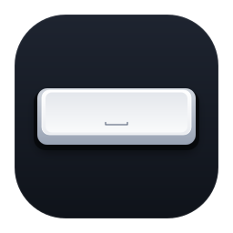
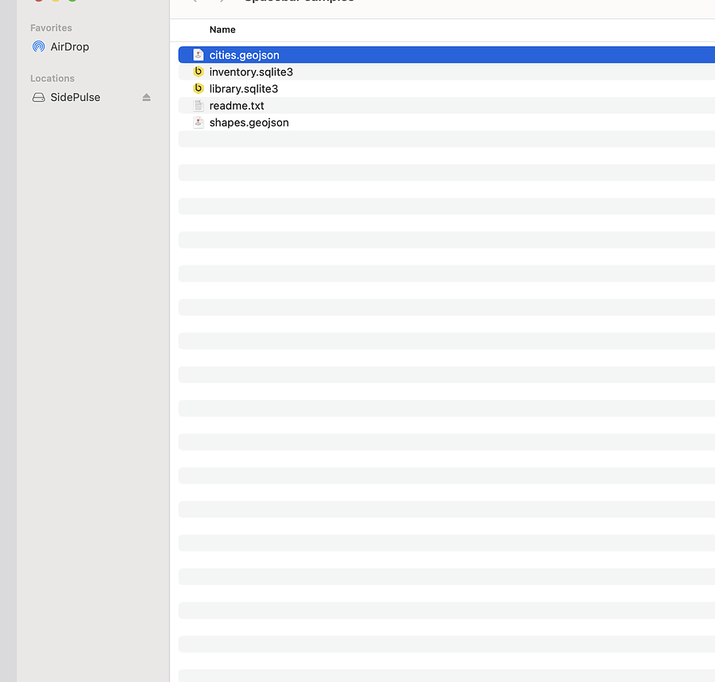

<h1> Spacebar</h1>

Spacebar lets you preview lots of different kinds of files in the macOS Finder, like .sqlite3 and .geojson

It also lets developers write plugins to support more kinds of files - just by writing html and javascript!



## Install

```
brew tap gregsadetsky/tap
brew trust gregsadetsky/tap
brew install --cask spacebar
```

> Note: the app is not currently signed with an Apple developer id (I'll do it after I get 10ish stars on GitHub!).
>
> For now, either go to System Settings → Privacy & Security → (find the app at the bottom of the window, then click) Open Anyway
>
> ... or, run  
> `xattr -dr com.apple.quarantine ~/Applications/Spacebar.app`

If previews don't show, go to: *System Settings → General → Login Items & Extensions → Quick Look* and make sure that Spacebar is enabled

## Plugins

Shipped with the app:

- `.geojson`: map of the features, hover for properties
- `.sqlite3` `.sqlite` `.db`: tables, rows, schema

In the next release (or a local build):

- `.plist`: binary, XML and OpenStep property lists, with a collapsible tree,
  JSON view and copy as JSON. All local; the original file is never modified.

## Update

```
brew update
brew upgrade --cask spacebar
```

(the app opens once after the upgrade; that launch installs the new bundled plugins)

## Uninstall

```
brew uninstall --zap --cask spacebar
```

or by hand: delete `~/Applications/Spacebar.app` and `~/Library/Containers/io.spacebar.app.QuickLook` (that folder holds the installed plugins). From a clone of this repo, `make uninstall` does both.

## Notes

- a plugin is a folder with: plugin.json, index.html, your js - see [PLUGINS.md](https://github.com/gregsadetsky/spacebar/blob/main/PLUGINS.md)
- Spacebar includes GeoJSON, SQLite and property list plugins
- to write your own plugin, run `scripts/new-plugin.sh`

## How to develop

(you don't need to do this to write plugins)

`make install`, `make test`, `make smoke`, `make release`

Before `make install`, remove any Homebrew copy with
`brew uninstall --cask spacebar`. The local build goes in `~/Applications`;
leaving the brew copy in `/Applications` makes the two Quick Look extensions
compete. Homebrew users get new host capabilities and bundled plugins only
after a release and cask update.

MIT
